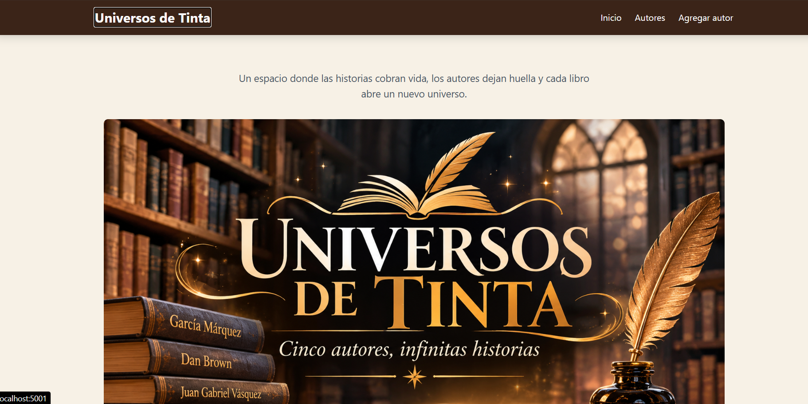
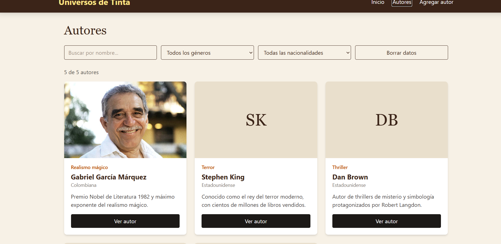
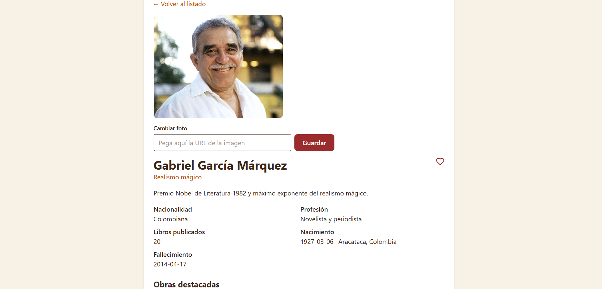
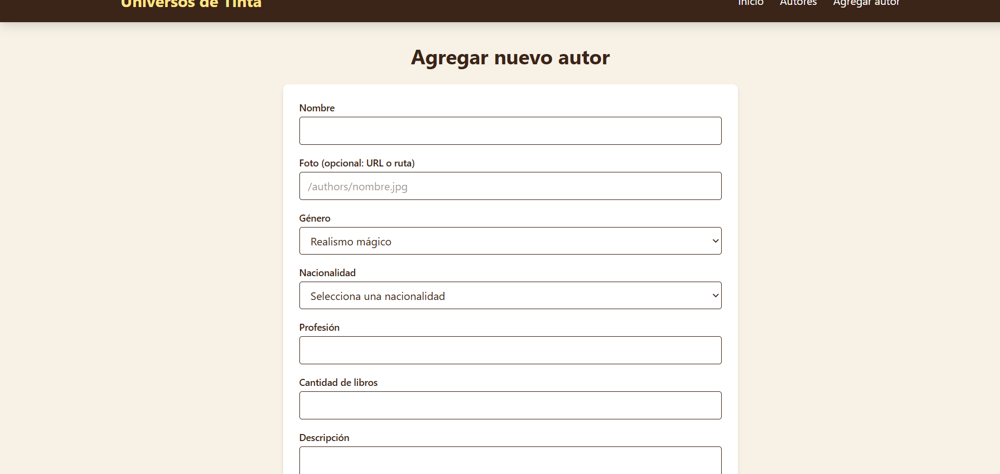

## Universos de Tinta

Universos de Tinta es un proyecto que desarrollé con React 19. La idea es crear un espacio donde las personas puedan conocer diferentes autores, leer un poco sobre su vida y descubrir algunas de sus obras. Desde la aplicación se pueden agregar, editar y eliminar autores, consultar sus detalles, marcar favoritos y cambiar sus fotografías pegando una URL. La información se guarda en una API que funciona con json-server.

Tecnologías: React 19 · Vite · Tailwind CSS 4 · React Router 7 · json-server · react-toastify · react-icons · react-spinners.

## Instalación y ejecución

Requisitos previos

Node.js 18 o superior.

npm (viene incluido con Node.js).

Pasos

1. Clonar el repositorio:

git clone https://github.com/juanitarodriguezjaramillo-create/prueba/
C:\Users\juani\OneDrive\Desktop\proyecto react final

2. Instalar las dependencias:

npm install

3. Iniciar la API en una terminal:

npm run server

La API queda disponible en:

http://localhost:5000/authors

4. Iniciar la aplicación en otra terminal:

npm run dev

La aplicación queda disponible en:

http://localhost:3000

5. Abrir http://localhost:3000 en el navegador.

⚠️ Es importante tener los dos servicios funcionando al mismo tiempo, porque la aplicación necesita la API para consultar y guardar la información de los autores.

También configuré el comando npm start con concurrently para poder iniciar la aplicación y la API desde una sola terminal.

npm start
---

##  Requisitos implementados

Leyenda: ✅ cumplido · ⚠️ parcial · ❌ no implementado

## Núcleo (obligatorio)

 Mostrar el listado de autores.

 Tener una portada principal con título, descripción e imagen.

 Consultar la información de cada autor.

 Agregar nuevos autores.

 Editar la información de los autores.

 Eliminar autores.

 Mostrar información biográfica.

 Mostrar las obras destacadas de cada autor.

 Buscar y filtrar autores.

 Marcar y quitar autores de favoritos.

 Mostrar una fotografía para cada autor.

 Cambiar las fotografías pegando una URL.

## Intermedio

 Agregar y eliminar obras desde el formulario.

 Validar los campos antes de guardar la información.

 Mostrar mensajes cuando algún campo tenga errores.

 Organizar los autores mediante paginación.

 Tener una página para consultar los autores favoritos.

 Mostrar primero los autores agregados más recientemente.

## Reto React 19

 RT-02: Implementé useFormStatus para controlar el envío de los formularios.

 RT-03: Utilicé useOptimistic para que los cambios de favoritos se vean inmediatamente.

RT-05: Utilicé la etiqueta <title> para cambiar el título de cada página.

## Decisiones técnicas
Cómo manejé los favoritos

Para los favoritos decidí guardar un campo llamado favorite en el archivo autores.json. Para cambiar su valor utilicé el método PATCH en lugar de guardar los favoritos en localStorage.

Lo hice así por las siguientes razones:

La información queda guardada: si actualizo la página, los autores que marqué como favoritos siguen apareciendo.

Cada autor tiene su propio estado: puedo saber fácilmente cuáles están marcados como favoritos.

Utilicé PATCH: porque solamente necesito cambiar el campo favorite, sin modificar los demás datos del autor.

Utilicé useOptimistic: para que el corazón cambie inmediatamente cuando marco o quito un favorito.

En la página de Favoritos muestro solamente los autores que tienen el campo favorite en true.

Manejo de las fotografías

Quise que cada autor tuviera su propia fotografía y que fuera posible cambiarla cuando quisiera.

Para esto creé el componente AuthorPhoto, que se encarga de mostrar la captura_n. Si la URL no funciona o la fotografía no carga, aparecen las iniciales del autor.

También creé PhotoUrlForm, donde puedo pegar una nueva dirección de captura_n y guardarla. El cambio se actualiza en la API mediante PATCH.

## Problemas encontrados y cómo los resolví

1. Problemas al importar algunos componentes.

Al principio me aparecieron errores porque algunos archivos importaban componentes que todavía no había creado, como FavoriteButton.

Solución: creé los componentes que hacían falta y revisé que las rutas de importación estuvieran correctas.

2. Algunas fotografías de los autores no aparecían.

Tuve problemas con algunas imágenes porque las direcciones que utilizaba no eran correctas o no permitían mostrar la fotografía en mi aplicación.

Solución: creé el componente AuthorPhoto para detectar cuando una captura_n no carga y mostrar las iniciales del autor en su lugar.

3. Problemas al conectar la aplicación con la API.

Al principio tenía dudas porque la aplicación se ejecutaba en el puerto 3000 y la API en el 5000.

Solución: configuré un proxy en vite.config.js para que las peticiones de la aplicación llegaran correctamente a json-server.

4. Al actualizar los favoritos podía modificar otros datos.

Me di cuenta de que al actualizar un autor debía tener cuidado de no cambiar información que no necesitaba modificar.

Solución: utilicé PATCH para actualizar solamente el campo favorite y conservar los demás datos.

5. Dificultades para agregar varias obras en el formulario.

Las obras se guardan como arreglos, pero necesitaba poder agregarlas y quitarlas desde el formulario.

Solución: implementé campos dinámicos y funciones que permiten convertir la información del formulario al formato que utiliza la API.
---

## 📸 Capturas de pantalla

### Portada

### Listado de películas

### Detalle de película

### Formulario

---